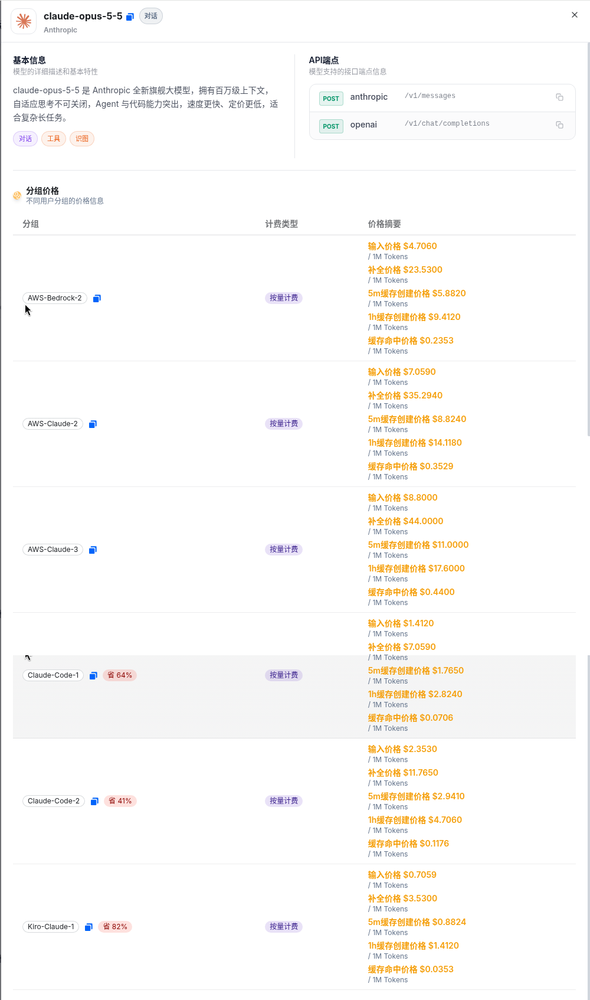

# Claude Opus 5.5 API 调用教程：用 TryAllAPI 做 OpenAI 兼容对话接入

> **Claude Opus 5.5**（模型 ID：`claude-opus-5-5`）是 Anthropic 旗舰对话模型。本文记录如何通过聚合站 **[TryAllAPI](https://tryallapi.com/)**，从模型广场 / 价格页选型、读官方价与分组倍率，到 `POST /v1/chat/completions`（以及 Anthropic Messages）的完整 **对话 API** 接入流程。价格与分组倍率**以页面实时为准**；示例仅为请求形态说明，未跑通真实长任务计费。

**Keywords:** Claude Opus 5.5 · Claude API · TryAllAPI · OpenAI 兼容 · `claude-opus-5-5` · `/v1/chat/completions`

---

## 目录

- [为什么用聚合站调对话模型](#一为什么用聚合站调对话模型)
- [在价格页 / 模型广场找到 Claude Opus 5.5](#二在价格页--模型广场找到-claude-opus-55)
- [模型怎么选：Opus 5.5 与相邻 Claude 档](#三模型怎么选opus-55-与相邻-claude-档)
- [价格怎么读](#四价格怎么读)
- [调用流程：Key → Base URL → chat/completions](#五调用流程key--base-url--chatcompletions)
- [curl / SDK 最小示例](#六curl--sdk-最小示例)
- [常见注意](#七常见注意)
- [FAQ](#faq)
- [小结与试用入口](#八小结与试用入口)

---

## 一、为什么用聚合站调对话模型

对话 / Agent 场景通常是 **同步 completions**：一次 `POST` 拿 `choices[].message`（或流式 chunk）。若业务同时要接 GPT、Claude、Gemini、以及视频模型，为每个厂商维护一套 Key、签名与重试逻辑会很散。

聚合站（如 [TryAllAPI](https://tryallapi.com/)）的常见价值是：

1. **统一鉴权**：一个 Bearer Key，切换 `model` 字段即可试不同档位；
2. **OpenAI 兼容形态**：Base URL 固定为 `https://tryallapi.com/v1`，多数 SDK / Cursor / Dify 可直接改地址；
3. **模型广场可对照**：标签（对话 / 工具 / 识图）、分组倍率、端点类型一目了然。

下面以价格页 / 广场可见的 **`claude-opus-5-5`** 为主线。注册试用入口：[https://tryallapi.com/register?aff=5A6A](https://tryallapi.com/register?aff=5A6A)。

---

## 二、在价格页 / 模型广场找到 Claude Opus 5.5

打开 [价格页](https://tryallapi.com/pricing) 或模型广场，按供应商 **Anthropic**、类型 **对话**、关键词 `opus` / `claude-opus-5-5` 筛选。详情卡截图如下：



截图里详情卡要点（与广场文案一致）：

| 字段 | 内容 |
| --- | --- |
| **模型 ID** | `claude-opus-5-5` |
| **供应商** | Anthropic |
| **描述 gist** | 百万级上下文；自适应思考不可关闭；Agent / 代码能力突出 |
| **标签** | 对话、工具、识图 |
| **API** | Anthropic：`POST /v1/messages`；OpenAI：`POST /v1/chat/completions` |
| **计费** | 按量（token）；分组见下节 |

同屏常见相邻卡：`claude-sonnet-5-5`、`claude-fable-5-1`、`claude-opus-5` 等。文中 UI 品牌可能为 momoAPIPro / 模型广场，实际对接产品以 [TryAllAPI](https://tryallapi.com/) 控制台与文档为准。

更完整的参数卡亦可对照官方文档站：[Claude Opus 5.5 API 指南](https://docs.tryallapi.com/claude-opus-5-5-api/)。

---

## 三、模型怎么选：Opus 5.5 与相邻 Claude 档

只根据广场 / 文档可见信息做选型对照，**不编造未出现的能力差异**：

| 模型 ID（可见） | 怎么理解（接入视角） |
| --- | --- |
| **`claude-opus-5-5`** | 当前旗舰对话卡：官方价档 $4 / $20（$/1M tokens）；thinking 自适应且不可关 |
| **`claude-sonnet-5-5`** | 同系列性价比档；官方文档站另有专页，适合日常编码默认 |
| **`claude-fable-5-1`** | 同供应商可见的高价 / 高 effort 档；任务极难再升档 |

实务上可以：默认先锁一个 `model` 字符串写进配置；遇限流或分组无货，再在同供应商的可见 ID 之间做降级，而不是改 endpoint。

---

## 四、价格怎么读

对话模型常见公式：**≈ 官方价 × 分组倍率**（以控制台为准）。

### 官方价（每百万 tokens，文档站核对）

| 项目 | 价格 |
| --- | --- |
| 输入 | **$4.00** |
| 输出 | **$20.00** |
| 缓存读 | **$0.20** |
| 5m 缓存写 | **$5.00** |
| 1h 缓存写 | **$8.00** |

来源：[docs.tryallapi.com/claude-opus-5-5-api](https://docs.tryallapi.com/claude-opus-5-5-api/)（取数快照）；**以 Anthropic / 控制台实时为准**。

### 分组价格（复现截图表格，$/1M tokens，按量）

截图「分组价格」表复现如下（**以页面实时为准**）：

| 分组 | 输入 | 输出 | 5m 缓存创建 | 1h 缓存创建 | 缓存命中 |
| --- | --- | --- | --- | --- | --- |
| **AWS-Bedrock-2** | $4.7060 | $23.5300 | $5.8820 | $9.4120 | $0.2353 |
| **AWS-Claude-2** | $7.0590 | $35.2940 | $8.8240 | $14.1180 | $0.3529 |
| **AWS-Claude-3** | $8.8000 | $44.0000 | $11.0000 | $17.6000 | $0.4400 |
| **Claude-Code-1**（截图标 Save 64%） | $1.4120 | $7.0590 | $1.7650 | $2.8240 | $0.0706 |
| **Claude-Code-2**（截图标 Save 41%） | $2.3530 | $11.7650 | $2.9410 | $4.7060 | $0.1176 |
| **Kiro-Claude-1**（截图标 Save 82%） | $0.7059 | $3.5300 | $0.8824 | $1.4120 | $0.0353 |

截图 API 端点同时列出：

- Anthropic 协议：`POST /v1/messages`
- OpenAI 协议：`POST /v1/chat/completions`

公式直觉仍是「官方价 × 分组倍率」；上表数字直接来自详情卡，**最终扣费以控制台流水为准**。

---

## 五、调用流程：Key → Base URL → chat/completions

整体是典型的 **OpenAI 兼容对话** 流水线：

```text
控制台创建 API Key（选 Claude 相关分组）
  → Base URL = https://tryallapi.com/v1
  → POST /v1/chat/completions   （model=claude-opus-5-5）
  → 读 choices[0].message.content
  → （可选）同 Key 走 Anthropic Messages：Base URL = https://tryallapi.com
```

建议：

- **超时**：高 effort / 长输出建议 120–180s；
- **密钥**：只放环境变量，勿提交仓库；
- **双协议**：Cursor / Dify 走 `/v1`；Claude Code 走 `ANTHROPIC_BASE_URL=https://tryallapi.com`，不要混在同一客户端配置里。

---

## 六、curl / SDK 最小示例

占位 Key `sk-xxx`（**不要**填入真实 Key）。

### 1）OpenAI 兼容 chat/completions

```bash
curl -sS https://tryallapi.com/v1/chat/completions \
  -H 'Authorization: Bearer sk-xxx' \
  -H 'Content-Type: application/json' \
  -d '{
    "model": "claude-opus-5-5",
    "messages": [
      {"role": "user", "content": "用三句话说明如何给这段代码写边界测试。"}
    ]
  }'
```

### 2）Python（OpenAI SDK）

```python
from openai import OpenAI

client = OpenAI(
    api_key="sk-xxx",  # 环境变量更安全
    base_url="https://tryallapi.com/v1",
)

r = client.chat.completions.create(
    model="claude-opus-5-5",
    messages=[{"role": "user", "content": "总结这份 RFC 的争议点"}],
)
print(r.choices[0].message.content)
```

### 3）Claude Code（settings.json 骨架）

```json
{
  "env": {
    "ANTHROPIC_BASE_URL": "https://tryallapi.com",
    "ANTHROPIC_AUTH_TOKEN": "sk-xxx"
  }
}
```

模型选 `claude-opus-5-5`（以客户端列表为准）。更多 Messages / 迁移说明见 [文档站专页](https://docs.tryallapi.com/claude-opus-5-5-api/)。

---

## 七、常见注意

1. **Thinking 不可关**：Opus 5.5 自适应思考常开；用 effort 调深度，勿沿用「disabled」旧字段。
2. **分组无货 → 403**：换 Claude-Code / Bedrock 等可见分组重试。
3. **模型名**：勿写成 `claude-3-opus` 等旧 ID；广场卡是 `claude-opus-5-5`。
4. **缓存账单**：Agent / Claude Code 会话大头常是缓存读 + 输出；小额烟测核对流水。
5. **合规**：敏感仓优先可审计通道；第三方聚合不是 Anthropic 官方服务。

---

## FAQ

### Claude Opus 5.5 的模型 ID 是什么？

广场 / 文档中的模型 ID 为 **`claude-opus-5-5`**。请求体 `"model"` 填该字符串。

### TryAllAPI 的对话 endpoint 是什么？

OpenAI 兼容：

- Base URL：`https://tryallapi.com/v1`
- 对话：`POST /v1/chat/completions`

Anthropic Messages / Claude Code：Base URL `https://tryallapi.com`（以控制台文档为准）。

### 官方价是多少？

文档站核对：**输入 $4 / 输出 $20 / 缓存读 $0.20**（每百万 tokens）。聚合侧再乘分组倍率；**以页面实时为准**。

### 如何试用 TryAllAPI？

站点首页：[https://tryallapi.com/](https://tryallapi.com/)；注册试用入口：[https://tryallapi.com/register?aff=5A6A](https://tryallapi.com/register?aff=5A6A)。

---

## 八、小结与试用入口

把 Opus 5.5 接到业务里，核心是：**在价格页确认 model id 与 OpenAI 兼容 Base URL → 读懂官方价 × 分组倍率 → 用同一套 chat/completions（或 Claude Code Base URL）出结果**。`claude-opus-5-5` + `https://tryallapi.com/v1` 已足够搭通最小链路。

| 资源 | 链接 |
| --- | --- |
| TryAllAPI 首页 | [https://tryallapi.com/](https://tryallapi.com/) |
| 注册试用（aff） | [https://tryallapi.com/register?aff=5A6A](https://tryallapi.com/register?aff=5A6A) |
| 文档站专页 | [claude-opus-5-5-api](https://docs.tryallapi.com/claude-opus-5-5-api/) |
| 相关仓库 | [awesome-claude-opus-5.5](https://github.com/xianyu110/awesome-claude-opus-5.5) |

控制台 Token、定价与文档更新后，以线上为准。详情卡截图见 `docs/model-square.png`（相对引用，Pages 可直接展示）。

---

## License

本文档以个人接入笔记形式发布，示例代码可自由复用。截图与模型广场文案归原平台；价格以实时页面为准。TryAllAPI 为第三方聚合，非 Anthropic 官方产品。
